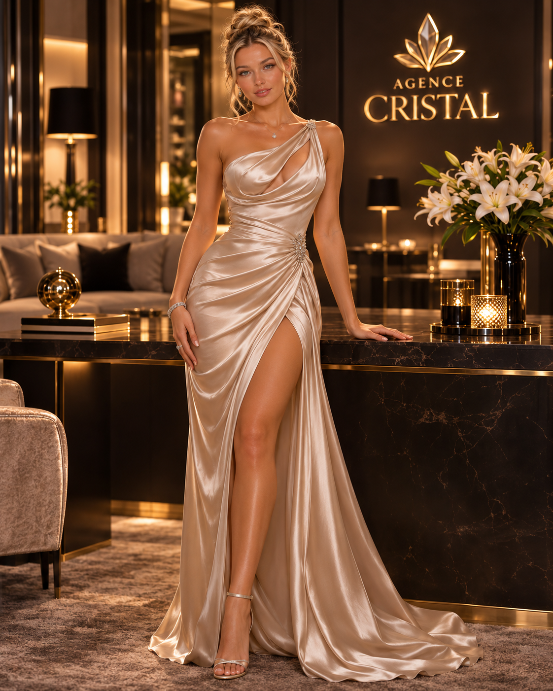

# Agence Cristal — Le bureau vivant de Cristal

**Statut : concept et texte d'accueil VALIDÉS par le porteur du projet le 16 novembre 2026.**
**Référence à préserver :** scénario d'accueil hollywoodien de la gérante virtuelle Cristal.
**Ce document est la référence artistique et rédactionnelle ; l'animation et le dialogue IA direct ne sont pas encore réalisés.**

## Vision

Le visiteur ne se contente pas de cliquer sur « Parler à Cristal » : **il entre dans le bureau de Cristal**.

Cristal est la **gérante virtuelle d'Agence Cristal**, chargée de l'accueil, des renseignements et de l'orientation des visiteurs. Elle n'est pas une quatrième hôtesse du catalogue. Elle possède son propre espace, distinct des personnalités Freyja, Amara et Nezuko.

## Direction artistique approuvée

- Ambiance **Hollywood classique**, élégante et légèrement mystérieuse, avec une pointe de suspense à la Hitchcock.
- Palette **noir, or et champagne** ; lumière chaude, tamisée et cinématographique.
- Bureau privé luxueux, mobilier raffiné, esprit grand hôtel / vieux Hollywood.
- **Cristal blonde en robe de satin champagne**, devant ou dans le décor noir et or. Utiliser le **portrait original validé**, sans en changer le visage ou la tenue. La photo de référence a été rappelée dans la conversation du 16 novembre 2026.
- Cohérence du visage, de la robe et du bureau d'une séquence à l'autre.
- Atmosphère raffinée, chaleureuse et accueillante ; jamais celle d'un banal chatbot.

## Scénario d'entrée imaginé

1. Une porte s'entrouvre sur la droite.
2. Cristal apparaît dans une pénombre dorée, portant sa robe champagne.
3. Elle avance avec élégance dans son bureau.
4. Elle s'approche du visiteur, se retourne, marque une pause et regarde la caméra.
5. Elle sourit, prend la parole et invite le visiteur à entrer dans son univers.
6. La conversation peut ensuite commencer dans l'interface de son bureau.

### Réplique cinématographique validée

> « Ah… vous voilà. Je commençais à me demander si vous oseriez pousser cette porte. Entrez, je vous en prie. »

## Texte d'accueil officiel — VERSION APPROUVÉE

**AGENCE CRISTAL**

### Bienvenue dans mon univers

*« Certaines rencontres commencent bien avant le premier mot. »*

Bonsoir, et bienvenue chez moi.

Je suis **Cristal**, maîtresse des lieux.

Ici, chaque personne a son histoire, chaque rencontre sa promesse, et chaque instant mérite une attention particulière.

Peut-être venez-vous par curiosité… Peut-être cherchez-vous une présence, une complicité, ou simplement quelqu'un qui saura vous écouter.

Quelle que soit votre raison, soyez le bienvenu.

**Entrez dans mon bureau. Nous avons certainement beaucoup à nous raconter.**

**Bouton d'action :** « ◇ Entrer dans le bureau de Cristal »

*Une expérience virtuelle · Un accueil personnel · Agence Cristal*

## Étapes d'intégration

1. Préserver ce texte, le portrait original et le concept du bureau hollywoodien.
2. Installer une version élégante de l'accueil dans le site mobile.
3. Ajouter une expérience immersive d'entrée dans le bureau (animation à réaliser).
4. Relier une **version professionnelle distincte** de Cristal à la conversation texte, puis éventuellement à la voix.
5. Veiller à isoler les conversations et les souvenirs personnels de ceux des visiteurs ; ne pas rendre publiques les instructions privées de Cristal.
6. Tester la compatibilité avec le parcours de contrôle d'âge / AgePass selon les espaces concernés.

## État technique connu au moment de la validation

- Site : `https://agence-cristal.enzonic.dev`, hébergement Enzonic lié au dépôt `jackk6103/agence-cristal`.
- Un panneau « Parler à Cristal » existe dans `src/components/CristalContact.tsx` ; il propose actuellement un **contact par e-mail**, pas encore une conversation IA directe.
- Ce panneau provisoire **n'est pas** l'expérience immersive finale du bureau.
- L'animation, la synthèse vocale et la liaison Botpress professionnelle sont des travaux à venir.

---

**Important : ne pas substituer un nouveau scénario ou une nouvelle identité visuelle sans validation.**

## Validation du nouveau portrait — 16 novembre 2026

Le porteur du projet a **expressément validé** une nouvelle illustration de Cristal, générée dans la conversation du 16 novembre 2026 après avoir partagé plusieurs références de robes et de coiffures contemporaines.

**Direction officielle du personnage, « Cristal 2026 » :**
- Personnage féminin fictif, blonde, allure élégante et très contemporaine.
- Coiffure moderne, relevée souplement avec quelques mèches encadrant le visage ; coiffures et tenues adaptables aux scènes.
- Robe couture **champagne satinée**, asymétrique à une épaule, drapée, avec fente élégante, sandales fines et bijoux discrets.
- Présence chaleureuse, sûre d'elle, séduisante et raffinée, sans esthétique de diva rétro.
- Décor d'accueil : bureau / salon haut de gamme, marbre noir, détails dorés, éclairage chaud, fleurs blanches, logo « AGENCE CRISTAL ».
- La direction artistique **Hollywood** reste celle d'un luxe cinématographique **actualisé pour 2026**, et non une reconstitution historique.
- Cette illustration validée constitue **la nouvelle référence visuelle à réutiliser pour les prochains développements** ; elle ne doit pas être confondue avec les portraits provisoires précédemment utilisés.

**Historique des décisions :** l'utilisateur a décrit l'image générée comme « moderne dans son apparence élégante et sexy à souhait », puis a confirmé « Oui c'est une cristal validée ».

**Précaution de continuité :** la validation du portrait ne signifie pas que les actifs actuels du site ont déjà été remplacés. Préserver le visage et la cohérence artistique de Cristal lors des futures scènes ; demander validation avant de remplacer les visuels actuellement déployés si l'image de référence doit être recadrée ou adaptée.

### Image officielle archivée dans le dépôt

**Portrait validé — fichier original en pleine résolution (1122 × 1402 px) :**

- Fichier : [`public/characters/cristal_2026_validee.png`](../public/characters/cristal_2026_validee.png)
- Image générée et expressément validée le 16 novembre 2026, conservée telle quelle en PNG.
- Destinée à servir de référence visuelle pour les animations du bureau, le futur accueil « Entrer dans le bureau de Cristal » et les déclinaisons de Cristal.
- **Ne remplace pas encore les images du site en production** sans une décision de déploiement spécifique.
